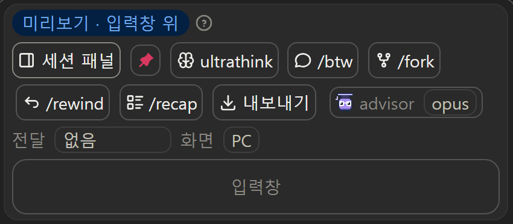
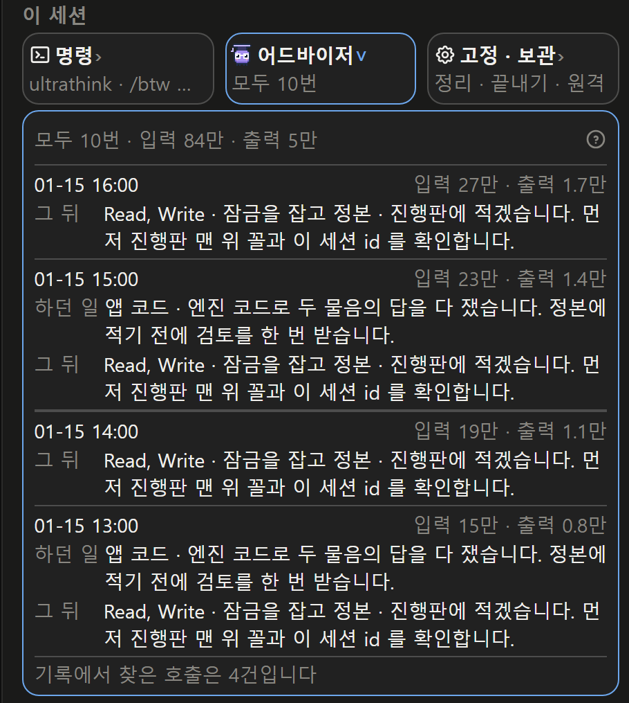
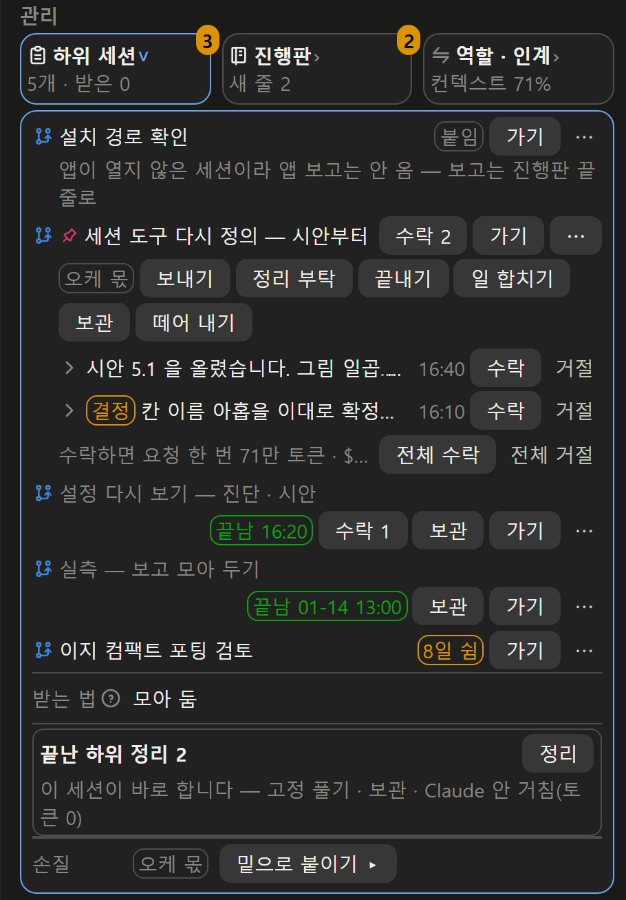
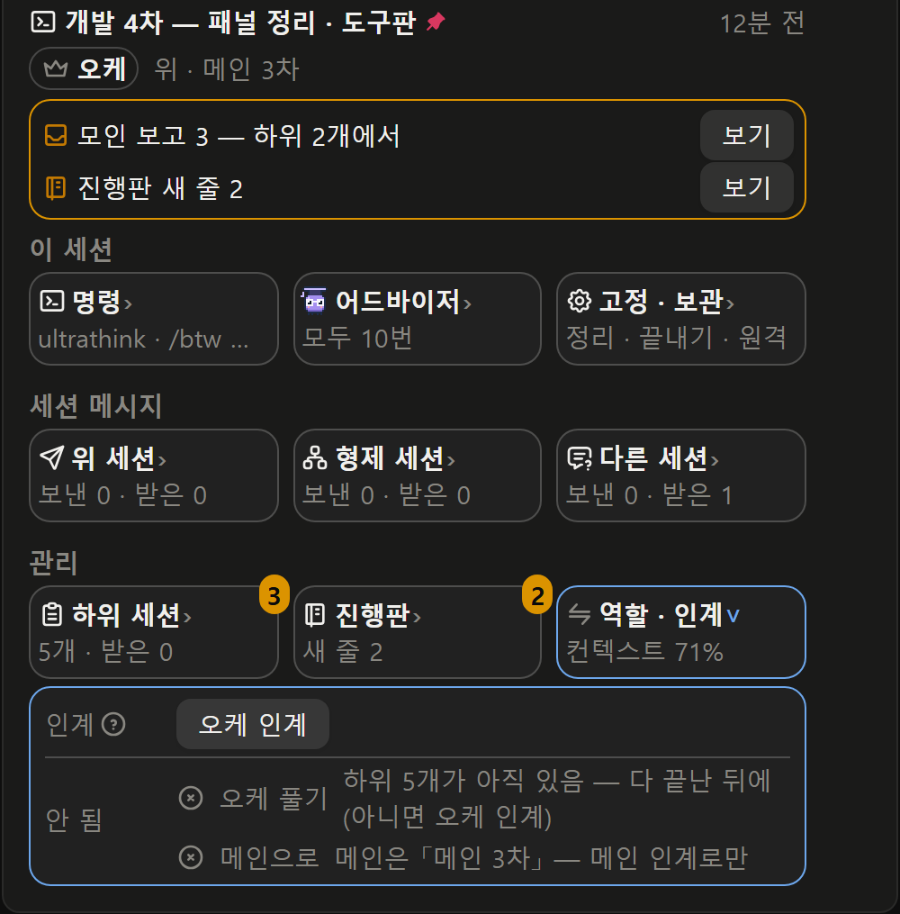
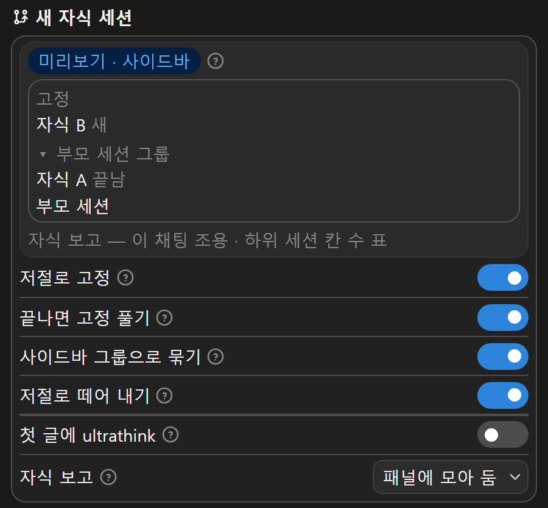

<h1 align="center">easy-session</h1>

<p align="center">
  <b>이 세션과 이어진 세션들을 보고, 한 패널에서 메시지 · 고정 · 인계 · 보관까지 합니다.</b><br>
  Claude Code 플러그인 · Claude 데스크톱 앱(Code 탭) · VS Code · 터미널 · Claude Code 2.1.325 에서 확인
</p>

<p align="center">
  
  
  
  
</p>

<p align="center">
  <a href="README.md">English</a> · <b>한국어</b>
  &nbsp;|&nbsp;
  <a href="#필요한-것">필요한 것</a> · <a href="#설치">설치</a> · <a href="#업데이트-받기">업데이트 받기</a> · <a href="#0131-에서-바뀐-것">바뀐 것</a> · <a href="#왜-필요한가">왜 필요한가</a> · <a href="#기능">기능</a> · <a href="#알아-둘-것">알아 둘 것</a> · <a href="#문제가-생기면--제보">제보</a>
</p>

<p align="center">
  
</p>

<p align="center"><b><a href="https://jaeseongha5280.github.io/easy-session/primer/ko.html">눌러 보는 안내서</a></b> — easy-session 화면을 직접 눌러 보며 장점을 봅니다</p>

---

## 필요한 것

| | |
|---|---|
| **보이는 곳** | Claude 데스크톱 앱의 **Code** 탭, VS Code 의 Claude Code 확장(채팅 패널), 터미널의 `claude`. 이지 세션은 데스크톱 앱이 적는 세션 기록을 읽습니다. 그래서 데스크톱 앱에선 모든 기능이 됩니다. VS Code · 터미널 세션은 데스크톱 앱 세션 트리 밖이라 고정 · 보관 · 떼어 내기와 위 · 형제 · 하위 세션이 없습니다. 그 부분은 흐리게 두고 까닭을 적거나 뺍니다. |
| **Claude Code** | **2.1.325** 에서 확인 — 데스크톱 앱 세션에서 `/status` → **Claude Code** 줄(앱 정보의 앱 버전 번호가 아님), 터미널은 `claude --version`. VS Code 는 Claude Code 확장 **2.1.326** 에서 봤습니다. 몇 버전부터 되는지는 아직 재지 않았습니다. |
| **업데이트** | 데스크톱 앱: **Claude → Check for Updates**(macOS) · **Help → Check for Updates**(Windows) 뒤 새 세션. 터미널: `claude update`. VS Code: Claude Code 확장 업데이트. |
| **git** | GitHub 에서 마켓을 추가할 때 필요 — `git --version` 이 버전을 찍으면 됩니다. macOS: 개발자 도구 설치 창이 뜨면 설치하세요. Windows: [Git for Windows](https://git-scm.com/downloads/win). |
| **언어** | 한국어 · 영어 — 패널 · 입력창 위 줄 · 알림 · Claude 에게 붙이는 줄. [설정] → 「화면 · advisor」 → 「언어 · Language」에서 고릅니다. 「자동」은 Claude Code 설정의 `language`, 데스크톱 앱 언어, OS 언어 가운데 먼저 찾은 것을 따릅니다 — 그것이 한국어면 한국어, 아니면 영어. |
| **선택** | PATH 의 Node.js — advisor 호출 목록과 남은 자료 세기 · 옮기기에 씁니다. 없으면 그 둘은 오류를 보입니다. |
| **시험한 곳** | Windows 11, 데스크톱 앱 · 터미널(Claude Code 2.1.325) · VS Code(Claude Code 확장 2.1.326). macOS · Linux 는 아직 시험하지 않았습니다. 두 동작은 Windows 프로그램을 불러서 그쪽에선 아직 안 됩니다: 세션으로 이동(`rundll32`) · 남은 자료를 휴지통으로(PowerShell). |

## 설치

**처음 한 번만.** 데스크톱 앱 · 터미널 · VS Code 의 Claude Code 확장은 같은 설정을 씁니다. 데스크톱 앱이나 터미널에서 한 번 설치하면 셋 다 됩니다(VS Code 는 설치 뒤 다시 켜기).

**가장 쉬운 길 — Claude 에게 이 한 줄을 보내세요**(데스크톱 앱 Code 탭이나 터미널 세션에서):

```
이 플러그인 설치해줘: github.com/JaeSeongHa5280/easy-session (claude plugin marketplace add JaeSeongHa5280/easy-session 후 claude plugin install easy-session@easy-session)
```

그다음 Claude 앱을 완전히 껐다 켭니다(터미널은 새 `claude` 세션). 입력창 위 줄에 **세션 패널** 단추가 뜹니다.

<details>
<summary><b>직접 치려면</b></summary>

**Claude 입력창에서 — 한 줄씩 따로 보내세요.** 첫 줄이 끝난 뒤 둘째 줄을 보냅니다. 두 줄을 한 번에 붙여 보내면 설치가 안 됩니다.

```
/plugin marketplace add JaeSeongHa5280/easy-session
```

```
/plugin install easy-session@easy-session
```

- **데스크톱 앱:** 첫 줄을 치면 **마켓플레이스 추가** 창이 뜹니다 — **동기화** 를 누르세요. 빨간 경고는 Anthropic 이 운영하지 않는 마켓이면 늘 뜨는 안내입니다. 둘째 줄을 치면 플러그인 목록에 easy-session 이 보입니다 — 설치하세요.
- **터미널 세션:** 둘째 줄을 치면 플러그인 정보가 열립니다 — **Install for you** 를 고르세요.

**터미널(macOS 터미널 · Windows PowerShell)에서:**

```
claude plugin marketplace add JaeSeongHa5280/easy-session
claude plugin install easy-session@easy-session
```

`claude` 명령이 없으면(데스크톱 앱만 쓰면 보통) 위의 한 줄을 Claude 에게 보내세요.

</details>

> **Claude 에게:** 먼저 엔진 버전을 보세요(`<엔진> --version`). 이지 세션은 2.1.325 에서 확인했습니다. 그보다 낮으면 사용자에게 알리고 먼저 업데이트를 권하세요([필요한 것](#필요한-것)). `claude` 가 PATH 에 없으면(데스크톱 앱이면 보통) 지금 도는 엔진으로 돌리세요 — 엔진 경로는 `CLAUDE_CODE_EXECPATH`, 없으면 `CLAUDE_PID` 의 실행 파일입니다. macOS · Linux: `"$CLAUDE_CODE_EXECPATH" plugin marketplace add JaeSeongHa5280/easy-session` 다음 `"$CLAUDE_CODE_EXECPATH" plugin install easy-session@easy-session`. Windows PowerShell: `& $env:CLAUDE_CODE_EXECPATH plugin marketplace add JaeSeongHa5280/easy-session` 다음 `& $env:CLAUDE_CODE_EXECPATH plugin install easy-session@easy-session`(변수가 없으면 `(Get-Process -Id $env:CLAUDE_PID).Path`). `git` 이 없어 마켓 추가가 실패하면 git 설치를 안내하세요(macOS 는 `xcode-select --install`). 이미 설치된 것을 업데이트할 땐 같은 엔진 경로로 `plugin marketplace update easy-session` 을 먼저, 그다음 `plugin update easy-session@easy-session` — 첫 단계 없이는 옛 버전을 최신이라고 답합니다. `plugin list` 에서 `easy-session@easy-session` 이 enabled 인지 보고, 앱을 완전히 껐다 켜 달라고 안내하세요(터미널은 새 `claude` 세션, VS Code 는 VS Code 다시 켜기). 이 저장소를 clone 하거나 `settings.json` 을 고치지 마세요.

## 업데이트 받기

**0.1.29 부터는 패널에서:** 세션 패널 맨 위 줄 오른쪽 끝의 판 단추(`v0.1.29 ▸`) → [업데이트 확인] → [업데이트] → Claude 앱 껐다 켜기. 새 판이 있으면 판 단추가 「0.1.31 업데이트」처럼 바뀝니다. 서랍엔 그 사이 판들의 바뀐 것이 나옵니다. 확인은 누를 때만 합니다. 단추가 Claude Code 를 못 찾거나 명령이 안 되면 서랍의 [입력칸에 넣기] 가 아래 한 줄을 입력칸에 넣습니다.

**0.1.28 이하는 버튼이 없어 아래 한 줄로 한 번 받습니다.**

**Claude 에게 이 한 줄을 보낸 뒤** Claude 앱을 껐다 켜세요(터미널은 새 `claude` 세션, VS Code 는 다시 켜기).

```
이 플러그인 업데이트해줘: easy-session (claude plugin marketplace update easy-session 후 claude plugin update easy-session@easy-session)
```

셸에서 직접 하려면 이 두 줄입니다:

```
claude plugin marketplace update easy-session
claude plugin update easy-session@easy-session
```

- 설치 줄을 다시 치면 "이미 설치됨"만 나옵니다. `plugin update` 만 치면 옛 버전을 최신이라고 답합니다 — 첫 줄이 새 목록을 받아 옵니다.
- 쓰던 설정은 그대로 남습니다.
- **새 버전을 저절로 받으려면:** 터미널 세션에서 `/plugin` → **Marketplaces** → **easy-session** → **Enable auto-update**. Anthropic 이 운영하지 않는 마켓은 꺼진 채로 시작합니다([Claude Code 문서](https://code.claude.com/docs/en/plugins/install)).
- 내 버전 번호: `claude plugin list`. 무엇이 바뀌었나: [변경 기록](CHANGELOG.ko.md).

<details>
<summary><b>지우기</b></summary>

```
claude plugin uninstall easy-session@easy-session
```

`~/.claude` 에 clone 하거나 `settings.json` 을 고친 것이 없어 이것으로 끝입니다.

</details>

## 0.1.31 에서 바뀐 것

- **권한 모드가 달라 버려지는 메시지 막기** — 받는 세션이 권한 무시 · 계획이고 이 세션이 그 밖 모드면 앱이 메시지를 붙잡았다가 몇 분 뒤 버립니다. 이제 위 세션 칸 [보내기]가 [카드로 보내기] · [받는 세션을 자동으로 내리고 보내기] · [이 세션을 권한 무시로 올리기] 가운데 고르게 합니다. Claude 가 그런 칸에 직접 보내려 하면 막고 할 일을 알려 줍니다.
- **하위 세션 권한 모드** — 하위 세션 칸에 권한 모드 줄과 줄마다 모드 · 마지막 활동이 보입니다. 메인 · 오케는 [하위 모두 자동으로]로 권한 무시 하위를 자동으로 내립니다.
- **끝난 하위 정리** — 이 세션이 권한 무시면 [정리]가 끝난 하위의 고정을 풀고 한 번에 보관합니다. 그 밖 모드면 [이 세션을 권한 무시로](앱 승인 카드 한 번) · [Claude 에게 줄마다 맡기기]가 있습니다.
- **보관 · 끝내기 전 남은 메시지** — 그 세션과 남은 메시지가 있으면 카드가 먼저 묻습니다 — [받고 보관] · [지우고 보관] · [남기고 보관].
- **모두 수락 · 모두 거절** — 한 칸에 보낸 세션이 둘 이상이면 모아 둔 메시지를 한 번에 받거나 지웁니다(지우기는 한 번 묻습니다).
- **「끝난 듯」** — 마지막 답 끝 두 줄 「남은 것」 · 「결정할 것」이 모두 「없음」인 하위 줄에 「끝난 듯」과 [끝내기]가 붙습니다. 끝남 기록은 누를 때만 씁니다.
- **글에 나온 세션 정보** — [설정] 「메시지」. 내 글에 다른 세션 제목이 나오면 그 세션 한 줄을 Claude 에게 붙입니다. 처음엔 꺼짐.
- **세션 규칙 · 패널 고침** — 60분 넘게 쉰 세션 · 여럿이 같이 쓰는 제목으로 보내기 전에 한 번 멈춥니다. 패널이 「Nothing to show yet」에 머물던 것을 고쳤습니다.

## 왜 필요한가

easy-session 은 advisor · ultrathink 같은 Claude Code 기능을 입력창 위에서 바로 켜고 끕니다. 언제 불렀고 무엇을 했는지 · 얼마 들었는지도 보입니다. 하위 세션의 보고가 위 세션을 깨우기 전에 받을지 고르게 합니다. 세션이 늘면 메인 · 오케 같은 역할과 세션 트리로 정리합니다.

| easy-session 없이 | easy-session 과 |
|---|---|
| 켜고 끄거나 모델을 바꿀 때마다 `/advisor` 를 침 | 입력창 위에서 advisor 를 바로 켜고 끄고 모델을 고름 — 이 세션 모델에 걸리는지 작은 그림으로 |
| *"advisor 를 언제 불렀고, 앞뒤로 뭘 했지?"* | **어드바이저** 칸에 부를 때마다 시각 · 토큰 · 바로 앞에 하던 일 · 바로 뒤에 한 일 |
| `ultrathink` 를 쳐 넣고 다시 지움 | 한 번 누르면 들어가고 다시 누르면 빠짐 — 깊게 생각할 차례만 골라서 |
| 얼마 드는지 안 보임 | 금액이 보임 — 입력창 위 advisor 횟수 · 금액(easy-compact 가 있으면), 식은 세션에 보내기 전 ❄ 카드의 두 값, 모인 보고를 받을 때 요청 한 번 값 |
| 세션에서 새 세션을 열면 그 세션이 차례를 끝낼 때마다 보고가 연 세션으로 올라옴 — 쉬던 세션은 보고를 읽느라 한 차례씩 돌고 그때마다 토큰이 듦 | 보고를 따로 모아 관리 — 보고만 든 차례는 막고 「지금」 칸 · 하위 세션 칸에서 하나씩 보기 · 받기 · 지우기 · 모두 받기, 받을 때 요청 한 번 값이 보임. 고른 보고만 받아 깨우는 차례 · 토큰이 줄어듦(설정 → 새 자식 세션 → 자식 보고 → 패널에 모아 둠) |
| *"이 답 메인에 보내 줘"* — 한 차례 더 | 이지 세션만의 명령 `>>위` · `>>메인`(또는 `>>up` · `>>main`) — 글 끝에 붙이면 차례가 끝날 때 답이 위 세션 · 메인으로 감. ➤ 는 친 글만 차례 없이 바로 |
| 어느 세션이 일을 나누고 어느 세션이 맡는지 매번 설명 | 역할 메인 · 오케 · 서브 · 단독 — 세션마다 제 일만 하게 하는 짧은 규칙 줄과 함께 |
| 무슨 일이 도는지 세션을 하나씩 열어 봄 | 패널 하나에 이 세션 위 · 옆 · 아래 세션 트리와 **지금** 칸(나를 기다리는 세션 · 모인 보고 · 받은 글) |
| 인계 글을 손으로 씀 | **인계** — 다음 차수가 자리 · 하위 세션 · 고정 · 진행판을 이어받음(메인 · 오케) |

## 데모 · 60초

https://github.com/user-attachments/assets/db221f37-a560-4dab-8d17-dc6d764644de

단계마다 직접 눌러 보려면 [눌러 보는 안내서](https://jaeseongha5280.github.io/easy-session/primer/ko.html)를 여세요.

## 기능

### 1. 입력창 위 줄



**세션마다 입력창 위에 한 줄이 생깁니다 — 데스크톱 앱 · VS Code · 터미널.** 맨 앞 **세션 패널** 단추(터미널에선 흐린 「이지 세션」 글 뒤)는 늘 있고 패널을 열고 닫습니다. 나머지는 [설정] → 「입력창 위 줄에 둘 것」에서 고릅니다:

| 칸 | 하는 일 | 처음 |
|---|---|---|
| 고정 | 이 세션을 사이드바에 고정하거나 고정을 풉니다 | 켬 |
| `ultrathink` | 입력창 맨 앞에 `ultrathink` 를 넣습니다(들어 있는 동안 무지개 글자). 다시 누르면 뺍니다. 그 글을 보낸 차례 동안은 채팅 작업 줄 글 앞에 `ultrathink · ` 가 붙습니다 | 켬 |
| advisor | advisor 모델(off · sonnet · opus · fable)을 고릅니다 — `/advisor` 처럼 모든 세션에 걸립니다. 작은 그림(터미널엔 없음)은 이 세션 모델에 걸리는지, 숫자는 이 세션에서 불린 횟수입니다(이지 컴팩트가 있으면 금액도). fable 은 먼저 묻습니다 | 켬 |
| 전달 | 이 차례 끝 답을 받을 곳을 위 세션 · 메인 가운데 고릅니다 — [3](#3-차례-끝-답을-위로) | 켬 |
| 화면 | 지금 어느 기기로 보는지 — [알아 둘 것](#알아-둘-것) | |
| `/btw` · `/fork` · `/rewind` | 입력창 맨 앞에 그 명령을 넣습니다. 보내는 건 사람입니다 | |
| `/recap` | `/recap` 을 돌립니다 | |
| 내보내기 | 이 대화를 zip 으로 다운로드 폴더에 저장합니다. VS Code · 터미널 세션에선 `/export` 를 돌려 대화를 글 파일(`conversation-<날짜-시각>.txt`)로 저장합니다 | |

Claude 가 답하는 동안엔 advisor · 화면을 바꿀 수 없습니다. 답이 끝나면 바꿀 수 있습니다.

**VS Code · 터미널에선** 고정 · 전달 칸이 없습니다 — 둘 다 데스크톱 앱이 있어야 됩니다. VS Code 의 `ultrathink` 무지개 글자는 VS Code 가 칠하는 색으로 그립니다. 터미널에선 ctrl+x tab 으로 이 줄에 갑니다. 단추는 글 단추입니다. 채팅 작업 줄 앞에 `ultrathink · ` 는 붙지 않습니다. 줄에서 패널을 연 뒤 shift+tab → ctrl+x tab → Tab 으로 패널 단추에 갑니다.

### 2. 세션 도구 탭

 



**패널 첫 탭 [세션 도구] 는 이 세션과 둘레 세션을 다룹니다.** 위에서 아래로:

- **제목 · 역할** — 이 세션 제목, 그 아래 역할 칩과 「위 · <위 세션 제목>」. 역할은 메인(그 세션 트리의 맨 위 오케 — 세션 트리마다 하나라 여럿일 수 있음) · 오케 · 서브(다른 세션 아래) · 단독입니다. 역할은 따로 저장하지 않습니다. 어느 세션이 어느 세션을 열었는지와 오케 표시로 읽습니다. 칩을 누르면 「역할 · 인계」 카드가 펴지고 다시 누르면 접힙니다.
- **지금** — 할 것이 있을 때만 주황 칸에: 입력을 기다리는 하위 세션(**열기** — 그 세션으로), 하위에서 모인 보고, 받은 글, 진행판 새 줄(**보기** — 그 칸을 폄). 서브 세션이 하위 세션을 열면 오케로 바꿀지도 여기서 묻습니다.
- **처음 한 번 묻는 카드** — 새 자식 세션 설정 · 자식 보고 값을 한 번도 바꾸지 않았으면 데스크톱 앱 세션 맨 위에 「추천 설정으로 시작할까요?」가 한 번 뜹니다. **추천대로 켜기** 는 자식 보고를 패널에 모아 둠 · 새 자식 저절로 고정 · 끝나면 고정 풀기 · 사이드바 그룹으로 묶기를 켭니다. **앱 그대로** 는 아무것도 바꾸지 않습니다. 어느 쪽이든 누르면 다시 뜨지 않습니다.
- **칸 아홉 · 묶음 셋** — 처음엔 편 칸이 없습니다. 칸을 누르면 그 줄 바로 아래 카드로 펴집니다(**›** 가 **˅** 로). 다시 누르면 접힙니다. 한 번에 하나만 펴집니다. 칸 아랫줄은 안에 든 것의 요약입니다 — 메시지 칸은 「보낸 N · 받은 N」. 이 세션 역할에서 안 쓰는 칸은 흐립니다. 칸 모서리의 주황 수는 그 칸에서 기다리는 것의 수입니다(눌러도 그 칸이 펴집니다). 카드 안은 줄마다 이름표와 단추입니다. 이름표 옆 **?** 에 그 줄 풀이가 있습니다.

| 묶음 | 칸 | 안에 있는 것 |
|---|---|---|
| 이 세션 | 명령 | `ultrathink` · `/btw` · `/fork` · `/rewind` · `/recap` · 내보내기. |
| | 어드바이저 | 이 세션에서 advisor 가 불린 때: 호출마다 때 · 토큰, 바로 앞에 하던 일, 바로 뒤에 한 일. advisor 답 내용은 읽지 않습니다. |
| | 고정 · 보관 | 세 줄. 표시: 지금 상태 스위치 셋 — 고정 · Remote Control · 끝남 표시. Remote Control 상태를 못 읽으면 그 스위치가 흐리고 「상태 못 읽음」이 붙습니다. 끝남 표시를 켤 때만 한 번 묻습니다. 정리: 정리(노트 고치기 · 커밋 · 진행판 끝 줄을 시키는 지시 글) · 제목 정리(역할 꼴로). 닫기: 보관 · 떼어 내기(되돌릴 수 없음). |
| 세션 메시지 | 위 세션 | 위 세션 줄(이름표 「이전 차수」 · 「연 세션」 · 「주인」)과 **보내기**, 메인이 바로 위가 아니면 「메인」 줄(**보내기** · **가기**), 보낸 글과 도착 여부. **보고 꼴로** 는 다섯 칸 보고 글(끝난 것 · 하는 중 · 막힌 것 · 기다리는 결정 · 다음)을 입력칸에 넣고 끝에 전달 신호를 붙입니다 — 보내면 답이 위로 갑니다. 메인 · 맨 위 오케는 **보고 꼴로 — 채팅에**. 받는 세션이 권한 무시 · 계획이고 이 세션이 그 밖 모드면(앱이 붙잡아 몇 분 뒤 버리는 칸) **보내기** 가 보낼 칸 자리에 고르기 셋을 띄웁니다 — **카드로 보내기** · **받는 세션을 자동으로 내리고 보내기**(일하는 중이면 그 차례가 끝난 뒤) · **이 세션을 권한 무시로 올리기**. 이 세션을 연 세션이 보고를 패널에 모아 두면 묻지 않고 카드로 갑니다. Claude 가 그런 칸에 직접 보내려 하면 막고 할 일(끝 답에 적기 · 자기 하위를 자동으로 내리기 · 사용자에게 묻기)을 알려 줍니다. |
| | 형제 세션 | 옆 세션마다 **보내기** · **가기**, 그리고 보낸 글. |
| | 다른 세션 | 「데스크톱 앱 밖 · 지금 열린 세션」 아래 지금 열린 VS Code · 터미널 세션(표지 「VS Code」 · 「터미널」, 줄마다 **보내기**), 그 밖 세션과 주고받은 글. 그 밖 세션에 보낼 때는 Claude 에게 보내 달라고 합니다(입력창 보내기는 위로만). |
| 관리 | 하위 세션 | 아래 세션들: 상태(끝남 · 끝난 듯 · 입력 필요 · 7일 넘게 쉼 · 붙임 · 다음 차수 — 「끝난 듯」은 마지막 답 끝 두 줄 「남은 것」 · 「결정할 것」이 모두 「없음」인 세션, 옆 **끝내기** 로 끝남 기록), **수락 N**(모인 보고 N개를 여기 Claude 에게), **보관**(끝난 뒤), **가기**, 보고를 하나씩 보는 **⋯**(수락 · 거절). 그 아래에 또 세션이 있으면 「› 아래 N」(입력 필요가 있으면 주황 「입력 필요 N」)을 눌러 깊이만큼 들인 줄로 폅니다(줄마다 표지 · **가기**). 메인 · 오케는 **⋯** 에 보내기 · 정리 부탁 · 끝내기 · 일 합치기(하던 일을 위로 넘기고 끝내 달라는 글) · 보관 · 떼어 내기가 더 있습니다. 「손질」 줄에는 **밑으로 붙이기**(다른 세션을 이 세션 아래로)가 있습니다. 칸에는 하위 세션 권한 모드도 보입니다(「권한 모드 — 자동 N · 권한 무시 M」 줄 · 줄마다 모드 낱말). 메인 · 오케는 그 줄 오른쪽 **하위 모두 자동으로** 로 권한 무시 하위를 자동으로 내립니다(일하는 중이면 그 차례가 끝난 뒤 · 트리로만 묶인 하위는 한 번 묻고). 끝난 하위가 있으면 「끝난 하위 정리」 상자가 생깁니다 — 이 세션이 권한 무시면 **정리** 가 Claude 를 거치지 않고 고정을 풀고 한 번에 보관합니다. 그 밖 모드면 바로 못 한다고 적고 **이 세션을 권한 무시로**(앱 승인 카드 한 번) · **Claude 에게 줄마다 맡기기**(보관 하나에 차례 하나)를 둡니다. 보관 · 끝내기 · 모두 보관 전에 그 세션과 남은 메시지(그 세션이 보낸 안 받은 글 · 그 세션에 보낸 안 읽힌 글)가 있으면 카드가 먼저 물어봅니다 — **받고 보관** · **지우고 보관** · **남기고 보관**. 고른 것은 대화에 한 줄로 남습니다. 남기고 보관한 글의 카드엔 「보관됨」이 붙습니다. |
| | 진행판 | 메인 · 오케: 고른 `.md` 진행판 — 「파일」 줄(**바꾸기**)과 「새 줄」 줄(**넣기** — 입력칸에 · **보기**). 서브는 위 세션의 진행판을 보입니다. |
| | 역할 · 인계 | **인계** — 상태를 적고 같은 역할로 다음 차수(`… N+1차`) 새 세션을 열라는 지시 글을 입력칸에 넣습니다. 새 세션은 첫 차례에 인계 자료만 읽고 보고합니다. 메인 · 오케의 다음 차수는 자리 · 하위 세션 · 고정 · 오케 표시 · 진행판을 이어받습니다. 곁가지의 다음 차수는 둘 다 열려 있는 동안 앞 차수 아래에 놓입니다(「이전 차수」 · 「다음 차수」). **바꾸기** 는 이 세션 역할만 바꿉니다: 오케로 · 오케 풀기 · 서브를 단독으로(떼어 내기) · 단독을 고른 오케 아래 서브로. 지금 안 되는 것은 「안 됨」 줄에 흐리게, 까닭과 함께 보입니다. 칸 아랫줄은 컨텍스트 % 입니다. |

받는 세션 캐시가 식었고 컴팩트하고 보내는 쪽이 싸면 보내기 전에 두 값을 견주는 카드가 뜹니다. 모인 보고를 수락하면 그 글이 여기 Claude 에게 내 메시지로 갑니다. 보고 아래 숫자는 지금 컨텍스트로 요청 한 번에 드는 값입니다. 보낸 세션마다 **전체 수락** · **전체 거절** 이 있습니다. 한 칸에 보낸 세션이 둘 이상이면 맨 위에 「보낸 세션 N · 글 M」과 **모두 수락**(차례 한 번) · **모두 거절**(「글 M개를 지웁니다 — 되돌릴 수 없음」으로 한 번 묻고 지움)이 생깁니다.

**VS Code · 터미널에선.** 이 세션들은 데스크톱 앱 세션 트리 밖이라 위 · 형제 · 하위 세션이 없습니다. 데스크톱 앱 도구도 없습니다:

- **패널 여닫기는 따로** — 데스크톱 앱 세션과 패널을 같이 여닫지 않습니다.
- **넓은 패널**(VS Code 에선 Claude 탭이 800px 이상일 때 채팅 옆에 열리는 패널 · 터미널의 패널): 위 세션 · 형제 세션 · 하위 세션 칸은 「데스크톱 앱에서만」 으로 흐립니다. 칸 아래 한 줄에 까닭이 있습니다. 「고정 · 보관」 칸은 「정리 · 끝내기」 가 됩니다 — 안에는 Remote Control · 끝남 표시 스위치와 정리 · 제목 정리 단추가 있습니다. Remote Control 은 Claude Code 의 `/remote-control` 을 돌립니다(claude.ai 구독 계정으로 로그인해 있어야 합니다). 그 세션에 이 명령이 없으면 입력칸에 부탁 글을 넣습니다. 고정 · 보관 · 떼어 내기는 흐린 「안 됨」 줄에 있습니다.
- **좁은 칸**(Claude 탭이 그보다 좁을 때 VS Code 가 입력창 위에 두는 12줄 칸): 패널이 목록이 됩니다 — 제목 · 역할 · 때가 한 줄, 그 아래 칸마다 `이름 ›` 과 지금 값이 한 줄. 줄을 누르면 바로 아래에 펴집니다. 데스크톱 앱에서만 되는 칸 · 줄은 뺍니다.
- **다른 세션** 칸에는 지금 열린 데스크톱 앱 세션이 트리 차례대로 「메인」 · 「오케」 표지와 **가기** 를 달고 나옵니다. 다른 VS Code · 터미널 세션도 나옵니다. 칸 아랫줄은 「열린 N · 받은 N」 입니다.
- **보내기** 는 권한 모드와 상관없이 바로 보냅니다. 데스크톱 앱 세션 안에서 띄운 터미널만 그 데스크톱 세션의 권한 모드를 따릅니다. 그 세션에 닿지 못하면 Claude 에게 보내라는 지시 글을 입력칸에 넣습니다(「바로 못 보내 입력칸에 넣었습니다」). 보낸 글은 「도착」으로 보입니다.
- **터미널에선** 제목 · 역할 · 때가 한 줄 글이고(누를 칩 없음), 칸은 묶음 이름 아래 `[이름 ›] 지금 값` 글 단추 목록입니다. 고르기는 가로로 늘어선 단추입니다.

### 3. 차례 끝 답을 위로

**글 끝에 `>>위`(또는 `>>up`)나 `>>메인`(또는 `>>main`)을 붙이면 Claude 가 그 차례를 끝낼 때 끝 답이 그 세션으로 갑니다.** `위` 는 바로 위 세션, `메인` 은 이 세션 트리의 맨 위 오케입니다. 입력창 보내기는 위로만 갑니다 — `>>이름` 은 보내지 않고 한 줄로 알립니다. 그 밖 세션에는 Claude 에게 보내 달라고 하세요. 입력창 위 **전달** 칸이 보낼 곳을 보여 줍니다. 여기서 위 세션 · 메인을 고르면 신호를 대신 써 줍니다. 「없음」을 고르면 취소합니다. 옆 **➤** 는 친 글만 바로 보냅니다. 이때 Claude 는 답하지 않습니다.

가는 길은 권한 모드에 따라 다릅니다:

- **Bypass permissions** 세션에서는 이지 세션이 직접 보냅니다.
- 그 밖의 모드에서는 Claude 에게 SendMessage 로 보내라고 합니다. 받는 세션이 Bypass permissions · plan 모드면 다른 모드의 메시지를 받지 않습니다. 그때는 글이 그 세션 패널에 카드로 남습니다. 수락은 거기서 합니다.
- 앱이 안 갔다고 알리면 그것도 카드가 됩니다. 어떻게 됐는지는 답 아래 알림 줄에 나옵니다.
- 받는 세션의 권한 모드가 이 세션과 다르면 지시 글 · 알림에 「붙잡힐 수 있음」 한 줄이 붙습니다. 막지는 않습니다 — 그 세션 모드를 맞추거나 그 세션에서 확인하세요.

보내기 신호는 데스크톱 앱 세션 사이에서 됩니다. VS Code · 터미널 세션에선 세션 패널에서 보내세요.

### 4. 설정 탭



**패널 둘째 탭 [설정].** 줄 이름 옆 **?** 에 풀이가 있습니다.

- **입력창 위 줄에 둘 것** — 맨 위에 입력창 위 줄 미리보기, 그 아래 [1](#1-입력창-위-줄)의 칸마다 스위치.
- **화면 · advisor** — 「언어 · Language」(자동 · 한국어 · English — [필요한 것](#필요한-것)), 그 아래 입력창 위 줄과 같은 두 값(화면 · advisor). 줄에서 뺐을 때 여기서 바꿉니다.
- **새 자식 세션** — 맨 위 「미리보기 · 사이드바」 가 지금 값으로 사이드바가 어떻게 보이는지 작은 그림으로 보입니다(스위치를 바꾸면 바로 바뀜). 세션이 다른 세션을 열 때 할 일: 저절로 고정 · 끝나면 고정 풀기(진행판에 끝 줄을 쓰면 풂) · 사이드바 그룹으로 묶기 · 저절로 떼어 내기 · 첫 글에 ultrathink(새 세션 첫 글 맨 앞에 `ultrathink` — 하던 일을 새 세션으로 넘기는 글에도). 「자식 보고」는 「앱 그대로」와 「패널에 모아 둠」 가운데 고릅니다. 앱 그대로면 연 세션이 보고를 받을 때마다 차례가 돕니다. 모아 두면 수락할 때까지 패널에 있습니다. 처음엔 스위치가 다 꺼져 있고 자식 보고는 앱 그대로입니다(처음 한 번 묻는 카드에서 추천대로 켤 수 있음). 저절로 떼어 낸 자식도 이지 세션의 세션 트리에선 부모 밑에 그대로 둡니다 — 직접 떼어 낸 세션만 맨 위로 갑니다. 그룹 · 떼어 내기는 Bypass permissions 세션에서만 됩니다. auto 세션의 고정 · 고정 풀기는 같은 세션 트리 위의 Bypass permissions 세션이 그 차례 끝에 대신합니다(없으면 안 됨).
- **메시지**
  - 보낸 세션 관계 알리기: 데스크톱 앱 세션이 다른 세션 글을 받으면 보낸 세션이 위 · 아래 · 같은 트리 · 다른 트리 · 데스크톱 앱 밖 VS Code · 터미널 세션 중 어디인지 Claude 에게 알립니다. 처음엔 꺼짐.
  - 세션 규칙(보내기 확인 · Claude 안내): 처음엔 켬. 데스크톱 앱 세션의 Claude 가 끝났거나 보관된 세션에, 또는 한 번 대답하는 동안 세 번째 다른 세션에 보내려 하면 이지 세션이 막고 Claude 가 먼저 사용자에게 묻게 합니다. 사용자가 답한 뒤의 같은 보내기는 통과합니다. 「끝난 세션」은 끝남 기록이 있는 세션입니다 — [끝내기]를 눌렀거나 · 끝남 표시가 됐거나 · 진행판에 끝 줄을 쓴 세션. 대답(차례)만 끝난 세션은 끝난 세션이 아닙니다. 받는 세션이 60분 넘게 쉬었으면 한 번 막고 「깨우면 처음부터 다시 읽는다」고 알립니다 — Claude 가 같은 보내기를 한 번 더 하면 갑니다. 제목이 같은 살아 있는 세션이 둘 이상인 제목으로 보내면 막고 `local_` id 로 보내라고 합니다. 서브에이전트가 부른 것 · 이지 세션이 부른 것은 안 봅니다. 사용자가 글을 보낼 때 Claude 에게 짧은 규칙 줄도 붙습니다(VS Code · 터미널 세션을 넣어 모든 세션) — 이어받은 세션의 첫 대답은 인계 자료만 읽고 보고하기 · 메인 · 오케 세션은 일을 직접 하지 말고 판단하고 맡기기 · 지시는 한 단계 아래로만. 데스크톱 앱 세션에서 인계 · 열기 · 위로 보내기를 말로 시키면 한 줄 안내가 붙습니다.
  - 글에 나온 세션 정보 붙이기: 내가 쓴 글에 다른 세션 제목(전체 · `[범위]` 뗀 제목 · 짧은 이름)이 나오면 그 세션 한 줄 — 제목 · id · 권한 모드 · 도는 중인지 쉬는지 · 고정 · 위인지 아래인지 · 앱 상태 요약 · 할 일 수 · 끝남 · 끝난 듯 — 을 Claude 에게 붙입니다(최근 셋까지). 슬래시 명령은 안 봅니다. 처음엔 꺼짐.
- **md 잠금** — 「md 잠금 보기 · 풀기」(처음엔 꺼짐 — 꺼져 있으면 잠금 폴더를 읽지 않음). 켜면 잠금 폴더(처음 값 `<Claude 설정 폴더>/locks`, **바꾸기** 로 고침)의 잠금마다 대상 · 남은 시간 · 주인 세션 · 할 일과 **풀기** 가 보입니다. **풀기** 는 파일을 지우지 않고 끝 시각을 지금으로 고쳐 씁니다. 주인 세션이 보관됐거나 끝났으면 차례 끝에 저절로 풉니다. 잠금 파일 꼴은 `locks/<이름>.json` 의 `holder_session_id` · `expires_at` 을 읽습니다.
- **정리** — 남은 자료: 보관한 세션이 임시 폴더에 남긴 스크래치 폴더(`.md` 가 아직 가리키는 것은 뺌). [설정]을 열 때 10분에 한 번 셉니다. ▸ 로 큰 것부터 봅니다. **휴지통으로** 는 먼저 묻고 Windows 휴지통으로 옮깁니다 — 휴지통에서 되돌릴 수 있습니다. 휴지통이 바로 지우게 설정됐거나 넘치게 되면 옮기지 않습니다.

**VS Code · 터미널에선** 스위치가 VS Code 는 「켬」 · 「끔」 드롭다운, 터미널은 [켬] [끔] 단추입니다. 데스크톱 앱에서만 되는 줄(입력창 위 줄의 고정 · 전달, 「새 자식 세션」)에는 「데스크톱 앱에서만 — 여기서 바꿔도 데스크톱 세션에 적용됩니다」 한 줄이 붙습니다. VS Code 의 12줄 칸에선 그 줄들과 미리보기를 뺍니다. 터미널에선 미리보기만 뺍니다.

## 알아 둘 것

- **권한 모드에 따라 다릅니다.** 앱을 바꾸는 단추(고정 · 보관 · 떼어 내기 · 내보내기 · Remote Control 켜기 · 끄기 · 보내기)는 **Bypass permissions** 세션에서만 바로 처리합니다. 다른 모드에선 입력창에 한 줄 부탁 글을 넣고(다시 누르면 뺌), 그 글을 보내야 처리됩니다. auto 모드에선 플러그인이 직접 부른 앱 도구를 데스크톱 앱이 돌리지 않고 「Claude 가 부르게 하라」며 돌려보내기 때문입니다(Claude Code 2.1.325 에서 확인). 권한 모드 단추 — **이 세션을 권한 무시로** · **이 세션을 권한 무시로 올리기** · **받는 세션을 자동으로 내리고 보내기** · **하위 모두 자동으로** — 는 어느 모드에서나 먼저 바로 부르고(올리기는 앱 승인 카드가 뜸), 앱이 거절할 때만 입력창에 부탁 글을 넣습니다. VS Code · 터미널 세션의 보내기와, 그 세션에서 Claude Code 명령(`/remote-control` · `/export`)으로 도는 Remote Control · 내보내기는 어느 모드에서나 바로 갑니다.
- **모든 것이 내 PC 안에서 돕니다.** 이지 세션은 네트워크 요청을 하지 않습니다. 세션 사이 메시지는 이 PC 의 Claude Code 세션 메시지 길로 갑니다. [업데이트 확인]을 누를 때만 Claude Code 가 GitHub 에서 마켓을 받아 옵니다.
- **화면은 모든 세션에 걸립니다(VS Code · 터미널 세션 포함).** PC · 태블릿 · 폰을 고르면 보내는 글마다 그 기기에 맞춰 답하라는 줄이 Claude 에게 붙습니다. 태블릿 · 폰이면 고르기 카드 · 그림 위젯을 막아 글로 묻게 합니다. 「쓰지 않음」(처음 값)이면 아무것도 붙지 않습니다.
- **VS Code 알림은 한 줄입니다.** VS Code 는 알림을 입력창 위에 쌓아 둡니다. 그래서 이지 세션은 알림 대신 패널 맨 아래 한 줄에 적습니다. 패널이 닫혀 있으면 입력창 위 줄 끝에 나옵니다. 된 일에만 「✓」 가 붙습니다. 다음에 무엇을 누르면 사라집니다.
- **금액은 고정 단가로 낸 어림입니다.** 구독 요금제라면 요청이 얼마나 무거운지를 보는 값으로 읽으세요.
- **제목 꼴:** 인계는 새 세션 제목이 다음 차수일 때 알아봅니다(`… 2차` → `… 3차`). 곁가지의 진행판 끝 줄은 `- MM-DD [이름] 끝: …` 꼴입니다. 둘 다 영어 화면에서도 이 꼴 그대로입니다.
- **[이지 컴팩트](https://github.com/JaeSeongHa5280/easy-compact)와 같이 쓰면:** advisor 횟수가 이지 컴팩트와 같아지고 금액도 보입니다 — 이지 컴팩트가 적는 작은 파일을 읽습니다. 입력창 위 여러 줄 가운데 이지 세션 줄이 맨 위에 옵니다.

## 문제가 생기면 — 제보

[이슈](https://github.com/JaeSeongHa5280/easy-session/issues)에 적을 것: 증상 · 재현 순서, 이지 세션 버전(`claude plugin list`), Claude Code 버전(`/status`), 본 곳(데스크톱 앱 · VS Code · 터미널), OS, 그 세션의 권한 모드. 패널 화면 캡처가 있으면 좋습니다. 이지 세션은 진단 파일을 만들지 않습니다. 스스로 밖으로 보내는 것도 없습니다.

## 라이선스

[MIT](LICENSE)
