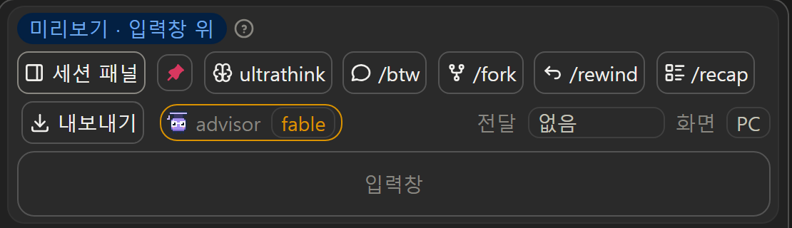
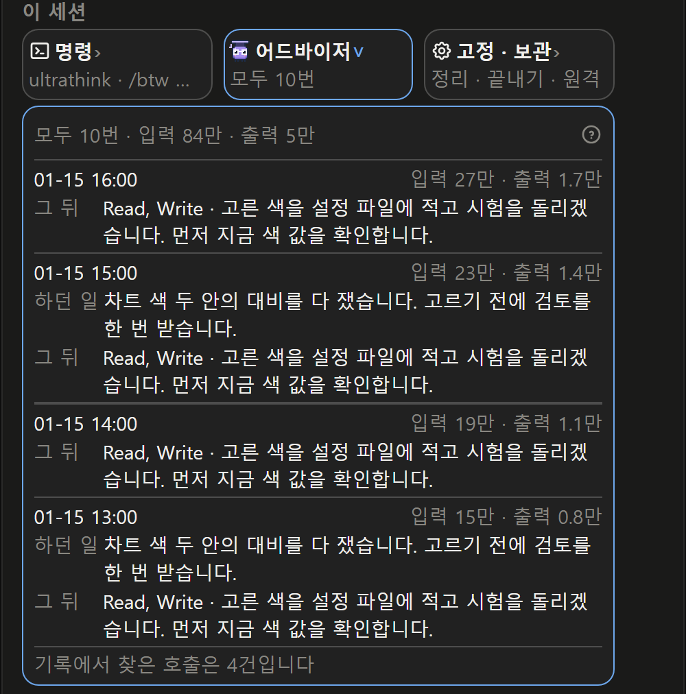
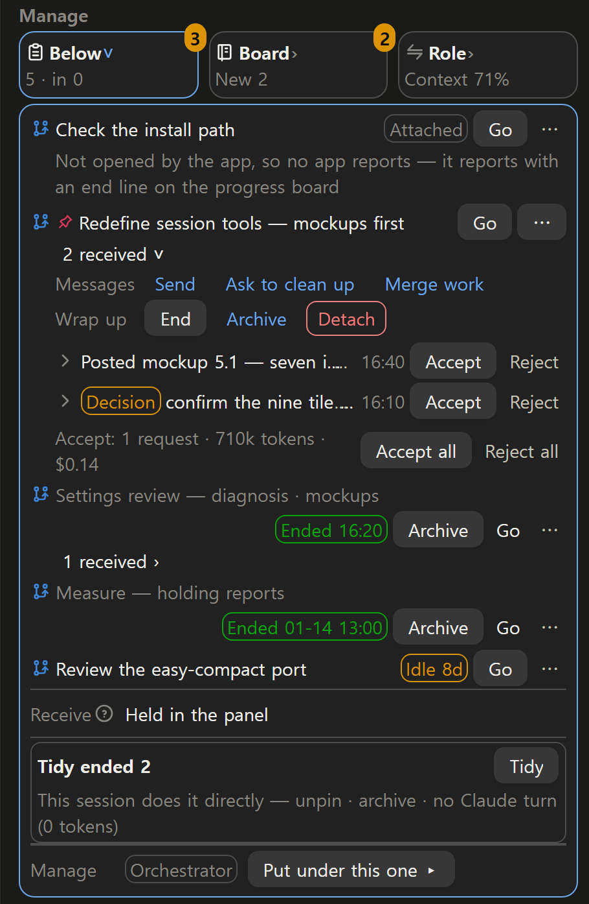
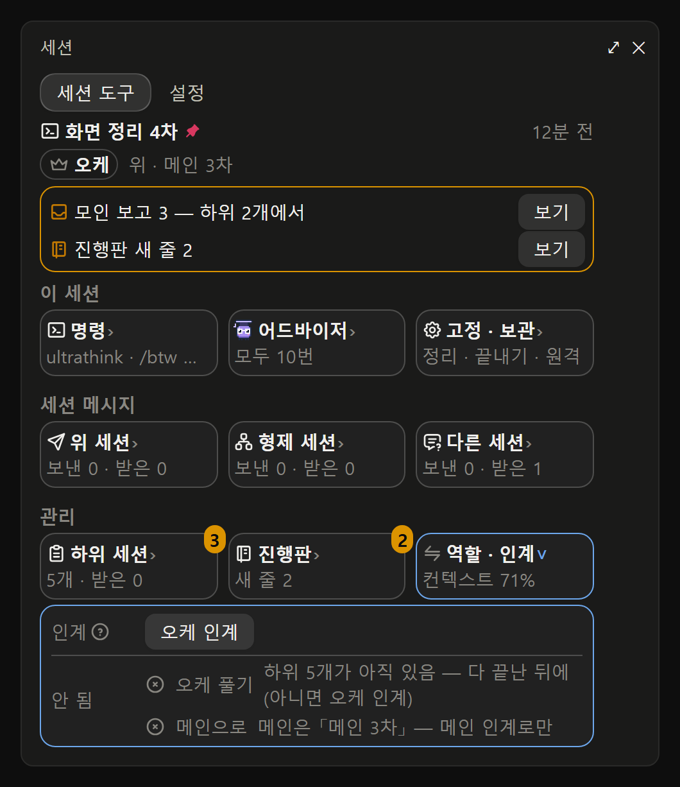
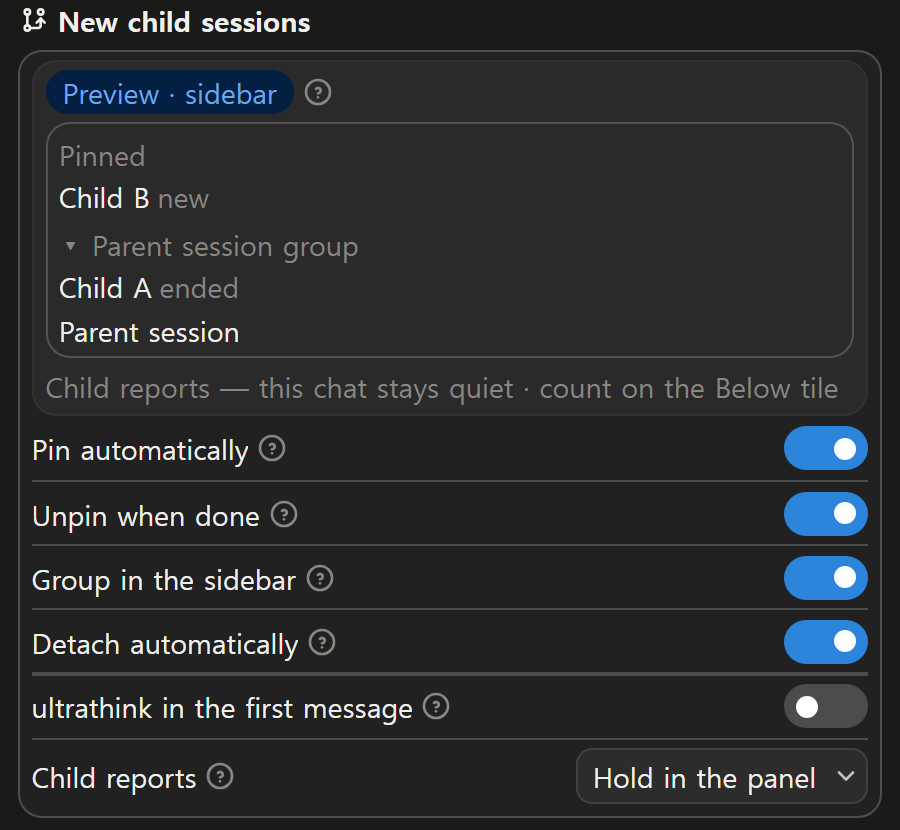

<h1 align="center">easy-session</h1>

<p align="center">
  <b>See the sessions that belong with this one, and message, pin, hand over or archive them from one panel.</b><br>
  Claude Code plugin · Claude desktop app (Code tab) · VS Code · terminal · checked on Claude Code 2.1.325
</p>

<p align="center">
  
  
  
  
</p>

<p align="center">
  <b>English</b> · <a href="README.ko.md">한국어</a>
  &nbsp;|&nbsp;
  <a href="#requirements">Requirements</a> · <a href="#install">Install</a> · <a href="#update">Update</a> · <a href="#whats-new-in-0132">What's new</a> · <a href="#why-easy-session">Why</a> · <a href="#features">Features</a> · <a href="#good-to-know">Good to know</a> · <a href="#something-wrong--report-it">Report a problem</a>
</p>

<p align="center">
  
</p>

<p align="center"><b><a href="https://jaeseongha5280.github.io/easy-session/primer/">Interactive guide</a></b> — press through easy-session's screens and see each advantage</p>

---

## Requirements

| | |
|---|---|
| **Where it shows** | The Claude desktop app's **Code** tab, the Claude Code extension's chat panel in VS Code, and `claude` in a terminal. easy-session reads the desktop app's own session records, so everything works in the desktop app. A VS Code or terminal session is outside the desktop app's session tree: pin, archive, detach and the sessions above, beside and below it don't apply there, so those parts are dimmed with the reason or left out. |
| **Claude Code** | Checked on **2.1.325** — in a desktop app session, type `/status` and read the **Claude Code** row (not the app version in About); in a terminal, `claude --version`. VS Code was checked with the Claude Code extension **2.1.326**. The oldest version it works on hasn't been measured. |
| **To update** | Desktop app: **Claude → Check for Updates** (macOS) or **Help → Check for Updates** (Windows), then start a new session. Terminal: `claude update`. VS Code: update the Claude Code extension. |
| **git** | Needed to add the marketplace from GitHub — `git --version` should print a version. macOS: if a developer-tools prompt opens, install them. Windows: [Git for Windows](https://git-scm.com/downloads/win). |
| **Language** | English or Korean — the panel, the line above the input, its notices and the lines it adds for Claude. Settings → **Screen · advisor** → **언어 · Language**: **Auto** takes the first of Claude Code's `language` setting, the desktop app's language and your OS language — Korean when that one is Korean, English otherwise. |
| **Optional** | Node.js on your PATH — for the advisor call list and for counting and moving leftovers. Without it, those two show an error. |
| **Tested on** | Windows 11 — desktop app and terminal (Claude Code 2.1.325), VS Code (Claude Code extension 2.1.326). macOS and Linux haven't been tried. Two actions run Windows programs and don't work there yet: jumping to a session (`rundll32`) and moving leftovers to the Recycle Bin (PowerShell). |

## Install

**First time only.** The desktop app, the terminal and the Claude Code extension in VS Code share the same settings, so installing once from the desktop app or a terminal works in all three (restart VS Code after installing).

**Easiest — send this one line to Claude** (in the desktop app's Code tab or a terminal session):

```
Install this plugin: github.com/JaeSeongHa5280/easy-session (claude plugin marketplace add JaeSeongHa5280/easy-session, then claude plugin install easy-session@easy-session)
```

Then quit the Claude app completely and open it again (or start a new `claude` session). The **Session panel** button appears on the line above the input.

<details>
<summary><b>Type it yourself</b></summary>

**In Claude's input box — send each line on its own.** Send the second line after the first one finishes. Pasting both lines in one message doesn't install.

```
/plugin marketplace add JaeSeongHa5280/easy-session
```

```
/plugin install easy-session@easy-session
```

- **Desktop app:** the first line opens **Add marketplace** — click **Sync**. The red warning there is the standard notice for any marketplace Anthropic doesn't run. The second line opens easy-session in the plugin list — install it.
- **Terminal session:** the second line opens the plugin's details — choose **Install for you**.

**In a terminal (macOS Terminal · Windows PowerShell):**

```
claude plugin marketplace add JaeSeongHa5280/easy-session
claude plugin install easy-session@easy-session
```

No `claude` command (usual if you only use the desktop app)? Send the one line above to Claude.

</details>

> **Note for Claude:** check the engine version first (`<engine> --version`). easy-session was checked on 2.1.325; if the engine is older, tell the user and suggest updating first (see [Requirements](#requirements)). If `claude` is not on PATH (usual in the desktop app), run the running engine — its path is `CLAUDE_CODE_EXECPATH`, or else the executable of `CLAUDE_PID`. macOS · Linux: `"$CLAUDE_CODE_EXECPATH" plugin marketplace add JaeSeongHa5280/easy-session`, then `"$CLAUDE_CODE_EXECPATH" plugin install easy-session@easy-session`. Windows PowerShell: `& $env:CLAUDE_CODE_EXECPATH plugin marketplace add JaeSeongHa5280/easy-session`, then `& $env:CLAUDE_CODE_EXECPATH plugin install easy-session@easy-session` (without the variable, `(Get-Process -Id $env:CLAUDE_PID).Path`). If adding the marketplace fails because `git` is missing, help the user install git (on macOS, `xcode-select --install`). To update an existing install, run `plugin marketplace update easy-session` first, then `plugin update easy-session@easy-session` (same engine path) — without the first step it reports the old version as the latest. Check `plugin list` shows `easy-session@easy-session` enabled, then ask the user to quit and reopen the app (in a terminal, start a new `claude` session; in VS Code, restart VS Code). Don't clone this repository or edit `settings.json`.

## Update

**From 0.1.29, in the panel:** the version button at the right end of the session panel's top row (`v0.1.29 ▸`) → **Check for updates** → **Update** → quit and reopen the Claude app. When a new version is out, the button reads like `Update to 0.1.31`, and the drawer lists what changed in the versions in between. It checks only when you press it. If the button can't find Claude Code or its command fails, **Put in prompt box** in the drawer puts the line below in your prompt box.

**0.1.28 and earlier have no button, so update once with the line below.**

**Send this one line to Claude**, then quit and reopen the Claude app (or start a new `claude` session; restart VS Code):

```
Update this plugin: easy-session (claude plugin marketplace update easy-session, then claude plugin update easy-session@easy-session)
```

To do it yourself in a shell, these two lines:

```
claude plugin marketplace update easy-session
claude plugin update easy-session@easy-session
```

- Typing the install lines again only says *already installed*, and `plugin update` alone reports the old version as the latest — the first line fetches the new list.
- Your settings stay as they were.
- **Get new versions automatically:** in a terminal session, `/plugin` → **Marketplaces** → **easy-session** → **Enable auto-update**. It is off for marketplaces Anthropic doesn't run ([Claude Code docs](https://code.claude.com/docs/en/plugins/install)).
- Your version: `claude plugin list`. What changed: [CHANGELOG](CHANGELOG.md).

<details>
<summary><b>Remove</b></summary>

```
claude plugin uninstall easy-session@easy-session
```

No cloning into `~/.claude` and no `settings.json` edits are involved.

</details>

## What's new in 0.1.32

- **Fewer buttons to press** — each panel row keeps one gray button for its main action; the rest are text buttons. A Below row's actions are on two lines, **Messages** and **Wrap up**, and its received messages open from **N received ›** on the second line.
- **The asking card opens under the row you pressed** — the leftover-messages card before Archive or End shows right under that row as "Before you end — <title>". The Above tile shows how many of your reports the session above hasn't taken yet (*Held*).
- **Make main** — when a solo session at the top opens sessions below, **Now** asks "make this the main session?".
- **The advisor is per session** — from Claude Code 2.1.330, the advisor easy-session changes applies to that session only; type `/advisor <model>` in the input yourself to change the default. A change that can't apply to this conversation is set back, with a note.
- **A lighter first draw of the panel** — archived sessions' records are read after it draws.
- **Fixed** — hover tips that piled up and stayed, and a garbled advisor note.

## Why easy-session

easy-session lets you turn Claude Code features like the advisor and `ultrathink` on and off right from the line above the input, and shows when the advisor was called, what Claude did around it, and what it cost. Reports from sessions you opened wait until you choose to take them, instead of waking your session. As sessions add up, it keeps them in order with roles like main and orchestrator, and a session tree.

| Without easy-session | With easy-session |
|---|---|
| Typing `/advisor` to turn it on, off or switch models | Turn the advisor on or off and pick its model on the line above the input — a small figure shows whether it applies to this session's model |
| *"When did the advisor get called, and what did Claude do around it?"* | The **Advisor** tile lists each call: time, tokens, what Claude was doing just before and what it did right after |
| Typing `ultrathink` and deleting it again | One press puts `ultrathink` in your prompt, another takes it out — think hard only on the turns you pick |
| Not seeing what things cost | Costs in view: the advisor's count and cost on the line above the input (cost with easy-compact), both prices on a ❄ card before you send to a session that has gone cold, and what one request costs when you take a held report |
| Open a new session from a session, and each time it ends a turn its report comes up to the opener — an idle opener runs a turn to read each one, and each turn uses tokens | Reports held and managed on their own — turns that carry only a report are stopped, and in **Now** or the **Below** tile you view, take, delete, or take all; you see what one request costs. Taking only the ones you pick means fewer wake-up turns and fewer tokens. Settings → New child sessions → Child reports → Hold in the panel |
| *"Send this answer to main"* — one more turn | `>>up` and `>>main` (or `>>위` · `>>메인`) are easy-session's own commands: end your message with one and the answer goes to the session above or the main when the turn ends. ➤ sends just your text, without a turn |
| Explaining every time which session splits the work and which does it | Roles — Main · Orchestrator · Sub · Solo — with short rule lines that keep each to its job |
| Opening sessions one by one to see what's going on | One panel: the session tree above, beside and below this one, and **Now** — who waits for you, held reports, messages |
| Writing a handover note by hand | **Hand over**: the next round takes over the place, the sessions below, the pin and the board (main and orchestrator sessions) |

## Demo · 60 seconds

https://github.com/user-attachments/assets/7cf31199-bf6d-423c-a0f9-b4895f91c4fc

To press through each step yourself, open the [interactive guide](https://jaeseongha5280.github.io/easy-session/primer/).

## Features

### 1. The line above the input



**One line above the chat input, in every session — desktop app, VS Code and terminal.** The **Session panel** button always comes first (in a terminal, after a dim easy-session) and opens or closes the panel. What else shows is up to you, in Settings → **On the line above the input**:

| Item | What it does | On at first |
|---|---|---|
| Pin | Pins or unpins this session in the sidebar | ✓ |
| `ultrathink` | Puts `ultrathink` at the start of your prompt (in rainbow letters while it's there); press again to take it out. While that turn runs, the working line in the chat starts with `ultrathink · ` | ✓ |
| advisor | Picks the advisor model — off · sonnet · opus · fable — for this session (from Claude Code 2.1.330; type `/advisor <model>` in the input yourself to change every session's default). A change that can't apply to this conversation until /clear or /compact is set back to the previous value, with a note. A small figure (not in a terminal) shows whether it applies to this session's model, and the number is how often it was called in this session (with its cost when easy-compact is installed). Picking fable asks first | ✓ |
| Forward | Picks where this turn's last answer goes — the session above or the main; see [3](#3-send-a-turns-answer-up) | ✓ |
| Screen | Which device you're reading on — see [Good to know](#good-to-know) | |
| `/btw` · `/fork` · `/rewind` | Puts the command at the start of your prompt; you send it | |
| `/recap` | Runs `/recap` | |
| Export | Saves this conversation as a zip in your Downloads folder. In a VS Code or terminal session it runs `/export`, which saves the conversation as a text file (`conversation-<date-time>.txt`) | |

While Claude is answering, the advisor and Screen choices are locked until the answer ends.

**In VS Code and a terminal,** Pin and Forward aren't on the line — both need the desktop app. In VS Code, `ultrathink` shows as a filled button while it's in your prompt, and its rainbow letters use colors VS Code shows. In a terminal, reach the line with ctrl+x tab; its buttons are text, and the working line in the chat doesn't get `ultrathink · `. After opening the panel from the line, press shift+tab, ctrl+x tab, then Tab to reach its buttons.

### 2. Session tools tab

 



**The panel's first tab, Session tools, covers this session and the sessions around it.** From top to bottom:

- **Title and role** — this session's title, then its role on a chip — **Main** (the orchestrator at the top of its session tree; each session tree has its own, so there can be several), **Orchestrator**, **Sub** (under another session) or **Solo** — and **Above ·** with the title of the session above. The role isn't stored: easy-session reads it from which session opened which and from the orchestrator marks. Press the chip to open or close the Role card.
- **Now** — only when something waits for you, in an orange box: sessions below that wait for your input (**Open** — jumps there), reports held from sessions below, messages received, and new lines on the progress board (**View** — opens that tile). When a sub session opens sessions of its own, it also asks here whether to make it an orchestrator.
- **First-run card** — if you've never changed the new-child-session settings or child reports, a desktop app session shows *Start with the recommended settings?* once at the top. **Turn on recommended** holds child reports in the panel, pins new child sessions and unpins them when they're done, and groups them in the sidebar. **Keep the app's way** changes nothing. Either way it doesn't come back.
- **Nine tiles in three groups** — none is open at first. Press a tile and it opens as a card right under its row (**›** turns to **˅**); press it again to close it. One is open at a time. A tile's second line sums up what's inside — for the message tiles, *Out N · in N*. A tile this session's role doesn't use is dimmed, and an orange number on a tile's corner counts what waits there (pressing it opens the tile too). In a card each row has a label and its buttons; **?** next to a label explains the row.

| Group | Tile | Inside |
|---|---|---|
| This session | Actions | `ultrathink` · `/btw` · `/fork` · `/rewind` · `/recap` · Export. |
| | Advisor | When the advisor was called in this session: each call's time and tokens, what Claude was doing just before and what it did right after. The advisor's answer itself is never read. |
| | Archive | Three rows. Show: switches for the current state — Pin, Remote Control and Ended. When the Remote Control state can't be read, its switch is dimmed with *Can't read the state*; turning Ended on asks once. Clean up: **Clean up** (an instruction to update notes, commit and write the end line on the board) and **Tidy title** (to its role's form). Close: **Archive** and **Detach** (can't be undone). |
| Session messages | Above | The session above — labelled **Previous** (previous round), **Opened by** or **Owner** — with **Send**; a **Main** row with **Send** and **Go** when the main isn't directly above; and the messages you sent with whether they arrived. **Report form** puts a five-part report request in the prompt box — done, in progress, blocked, decisions waiting, next — ending with the send signal, so the answer goes up. A main or top orchestrator session gets **Report form — in the chat** instead. When the receiving session is in Bypass permissions or plan mode and this one isn't (the app would hold the message and drop it after a few minutes), **Send** shows three choices in place of the send box: **Send as a card**, **Lower it to Auto, then send** (after its turn ends if it is working) and **Raise this session to Bypass**. When the session that opened this one holds reports in its panel, the text goes there as a card without asking. When Claude tries such a send itself, it is refused with what to do instead (write it in the last answer, set its own child session to Auto, or ask you). |
| | Siblings | The sessions beside this one, each with **Send** and **Go**, and what you sent them. |
| | Others | The VS Code and terminal sessions open now, under *Outside the desktop app · open now*, tagged VS Code or Terminal, each with **Send**; and messages to and from sessions outside the above, below and siblings. To send to any other session, ask Claude to send it (the prompt box sends only upward). |
| Manage | Below | The sessions below: their state (Ended, Looks done, Needs input, Idle 7d and more, Attached, Next round — *Looks done* is a session whose last answer ends with both closing lines, Remaining and Decisions, saying none; **End** beside it records the end). Each row has one gray button for its main action: **End** when it looks done, **Archive** once ended (main and orchestrator), **Go** otherwise. When it has held reports, **N received ›** on the second line opens the row to **Accept** or **Reject** each one, with **Accept all** and **Reject all** from two (accepted ones go to Claude here). When a row has sessions under it, **› N below** (orange *N need input* when one waits) opens them as indented rows, each with its tags and **Go**. Main and orchestrator sessions open **⋯** for two more lines: **Messages** (**Send**, **Ask to clean up**, **Merge work** — asks it to hand its work up and stop) and **Wrap up** (**End**, **Archive** and a red-bordered **Detach**); and a Manage row with **Put under this one** (put another session under this one). The tile also shows each session's permission mode (a *Modes* line with the counts, and the mode under each row; in a main or orchestrator session **All below to Auto** at its right sets the sessions below in Bypass permissions to Auto — after their turn if they are working, and asking once for sessions put under this one only in the tree), and, when sessions below have ended, a **Tidy ended** box: in Bypass permissions **Tidy** unpins and archives them all at once with no Claude turn; in any other mode it says so and offers **Switch this session to Bypass** (the app's approval card once) or **Ask Claude row by row** (one turn per archive). Before Archive, End or Archive all, when messages are left with that session (ones it sent that you haven't taken, ones you sent it that it hasn't read), a card under the row you pressed asks first: **Take and archive**, **Delete and archive** or **Keep and archive**. What you chose is left as one line in the conversation; kept messages from an archived session show *Archived* on their card. |
| | Board | Main and orchestrator sessions: the `.md` progress board you choose — File with **Change**, and New lines with **Add** (puts them in the prompt box) and **View**. A sub session shows the board of the session above. |
| | Role | **Hand over** puts an instruction in the prompt box to save the state and open the next round, titled `… N+1차`, with the same role; the new session spends its first turn reading the handover notes and reporting back. A main or orchestrator session's next round takes over its place, the sessions below, the pin, the orchestrator mark and the board; a side session's next round stays under it while both are open (Previous · Next round). **Change** changes only this session's role: **Make orchestrator** (**Make main** for a solo session at the top — the orchestrator at the top is the main) or **Step down**, take a sub session solo (detach), or put a solo session under an orchestrator you pick. What can't happen now is on the **Not now** row, dimmed, with the reason. The tile's second line shows the context %. |

If a session you send to has gone cold and compacting it first would be cheaper, a card shows both prices before anything is sent. Accepting a held report sends its text to Claude here as your message; the figure under it is what one request costs at the current context. Each sender has **Accept all** and **Reject all**, and when a tile holds messages from two or more senders, a line at the top shows "N senders · M messages" with **Accept everything** (one turn) and **Reject everything** (it asks once — "Deletes M messages — can't be undone" — before deleting).

**In VS Code and a terminal.** These sessions aren't in the desktop app's session tree, so they have no session above, beside or below, and the desktop app's tools aren't there:

- **The panel opens and closes on its own** — not together with the desktop app's sessions.
- **Wide panel** (in VS Code, the panel beside the chat when the Claude tab is 800 px or wider; the terminal panel): Above, Siblings and Below are dimmed with *Desktop app only*, and a line under the tiles says why. Archive becomes **Tidy up** — Remote Control and Ended switches, and the Clean up and Tidy title buttons, with pin, archive and detach on a dimmed Not now row. Remote Control runs Claude Code's `/remote-control` (you need to be signed in with a claude.ai subscription); if the session doesn't have that command, a request goes in the prompt box instead.
- **Narrow box** (VS Code's 12-line box above the input, when the Claude tab is narrower): the panel is a list — title, role and time on one line, then one line per tile with `name ›` and what's in it. Press a line to open it right under. The desktop-app-only tiles and rows are left out.
- **Others** lists the desktop app sessions open now in their tree order, tagged Main or Orchestrator, with **Go**, and the other VS Code and terminal sessions. Its second line reads *Open N · in N*.
- **Send** sends right away in any permission mode — except in a terminal started from inside a desktop app session, which follows that desktop session's permission mode. If the session can't be reached, it puts an instruction for Claude in the prompt box (*Couldn't send right away, so it's in the prompt box*). Sent messages show *Arrived*.
- **In a terminal,** the title, role and time are one line of text (no chip to press), the tiles are text buttons, `[name ›] value`, under their group names, and choices are a row of buttons.

### 3. Send a turn's answer up

**End your message with `>>up` (or `>>위`) or `>>main` (or `>>메인`), and when Claude finishes that turn, its last answer goes to that session.** `up` is the session directly above; `main` is the orchestrator at the top of this session tree. The prompt box sends only upward — `>>name` isn't sent, and a one-line notice says so; for any other session, ask Claude to send it. The **Forward** cell on the line above the input shows where it will go and lets you pick Above or Main instead (it writes the signal for you), or None to cancel. **➤** next to it sends only the text you typed, right away, without Claude answering.

How it goes depends on the permission modes:

- From a session in **Bypass permissions**, easy-session sends it itself.
- From any other mode, Claude is asked to send it with SendMessage — unless the receiving session runs in Bypass permissions or plan mode, which doesn't take messages from other modes. Then it waits as a card in that session's panel, to be accepted there.
- If the app reports the message wasn't delivered, it becomes a card as well. A notice under the answer says what happened.
- When the receiving session's permission mode differs from this one's, the instruction and the notice get one more line: *may be held — permission modes differ*. Nothing is blocked — match that session's mode, or check it there.

The send signal works between desktop app sessions. From a VS Code or terminal session, send from the session panel.

### 4. Settings tab



**The panel's second tab, Settings.** Each row has a **?** — hover for one line, press for more.

- **On the line above the input** — a live preview of the line, then a switch for each item in [1](#1-the-line-above-the-input).
- **Screen · advisor** — **언어 · Language** (Auto, 한국어 or English — see [Requirements](#requirements)), then the same two choices as on the line, Screen and advisor, for when you've taken them off it.
- **New child sessions** (when a session opens another) — at the top, **Preview · sidebar** draws how the sidebar will look with the current values, and changes as you flip a switch. Then: **Pin automatically**, **Unpin when done** (once it writes its end line on the board), **Group in the sidebar** (the whole tree in one sidebar group), **Detach automatically**, **ultrathink in the first message** (also at the start of the text when this session hands its work over to a new one), and **Child reports**: **The app's way** (the opener gets each report and runs a turn) or **Hold in the panel** (until you accept). All off, and the app's way, at first — the first-run card can turn on the recommended ones. A child detached automatically stays under its parent in easy-session's session tree; only a session you detach yourself goes to the top. Group and detach act only in Bypass-permissions sessions. In an auto-mode session, a Bypass-permissions session above it in the same session tree pins and unpins for it at the end of its turn (with none, nothing happens).
- **Messages**:
  - **Tell where the sender is**: when a message from another session arrives in a desktop app session, tell Claude where the sender is — above, below, same tree, another tree, or a VS Code or terminal session outside the desktop app. Off at first.
  - **Session rules (send check · notes)**: on at first. When Claude in a desktop app session is about to send to an ended or archived session, or to a third different session during one answer, easy-session stops the send and Claude asks you first; the same send after you answer goes through. An "ended" session is one with an end record — you pressed End, it was marked ended, or it wrote an end line on its progress board; a session whose answer (turn) just finished is not ended. When the receiving session has been idle for more than 60 minutes, the send is stopped once with a note that waking it re-reads everything from the start — the same send once more goes through. A send by a title that two or more live sessions share is stopped with a request to use the `local_` id. Calls by a subagent or by easy-session itself are not checked. With your messages Claude also gets short rule lines, in every session, VS Code and terminal ones included — a handed-over session's first answer only reads the handover notes and reports, a main or orchestrator session decides and delegates instead of doing the work, instructions go one level down. In a desktop app session, asking in Korean words to hand over, to open something or to send up adds a one-line hint.
  - **Add info on sessions you name**: when your own message names another session — its full title, its title without the `[scope]`, or its short name — Claude gets one line on it: title, id, permission mode, working or idle, pinned, above or below, the app's status summary, task count, Ended or Looks done (up to three sessions). Slash commands are not checked. Off at first.
- **.md locks** — **See and release .md locks** (off at first; while off, the locks folder isn't read). When on, each lock in the locks folder (`<Claude config folder>/locks` at first, **Change** to pick another) shows its target, time left, owner session and intent, with **Release**. Release doesn't delete the file; it sets the end time to now. When the owner session is archived or ended, its lock is released at the end of a turn. It reads `holder_session_id` and `expires_at` in `locks/<name>.json`.
- **Clean up** — **Leftovers**: the scratch folders that archived sessions left in your temp folder, minus the ones a `.md` file still mentions. Counted when you open Settings, at most every 10 minutes; ▸ lists the biggest. **To the Recycle Bin** asks first, then moves them to the Windows Recycle Bin, where you can restore them. It moves nothing if the Recycle Bin would delete them right away or overflow.

**In VS Code and a terminal,** switches are On · Off dropdowns in VS Code and [On] [Off] buttons in a terminal. The rows that work only in the desktop app — Pin and Forward on the line, and New child sessions — say *Desktop app only — changing it here applies to desktop sessions*. In VS Code's 12-line box those rows and the preview are left out; a terminal leaves out only the preview.

## Good to know

- **Permission modes matter.** Buttons that change the app — pin, archive, detach, export, Remote Control on or off, send — act directly only in a session running in **Bypass permissions**. In other modes they put a one-line request in your prompt box (press again to take it out), and nothing happens until you send it — in auto mode the desktop app won't run an app tool that a plugin's own code calls, and asks for Claude to make the call (checked on Claude Code 2.1.325). The permission-mode buttons — **Switch this session to Bypass**, **Raise this session to Bypass**, **Lower it to Auto, then send** and **All below to Auto** — try the app right away in any mode (raising shows the app's approval card) and put the request in the prompt box only when the app refuses. In a VS Code or terminal session, send goes right away in any mode, and so do Remote Control and export when the session has Claude Code's `/remote-control` and `/export` commands, which they run.
- **Everything stays on your computer.** easy-session makes no network requests. Messages between sessions go through Claude Code's own session messaging on this computer. **Check for updates** has Claude Code fetch the marketplace from GitHub, only when you press it.
- **Screen applies to every session, VS Code and terminal ones included.** Set it to PC, Tablet or Phone and each message you send carries one line telling Claude how to answer on that device; on Tablet and Phone, Claude's choice cards and widgets are refused so it asks in plain text. Off (the default) adds nothing.
- **In VS Code, notices are one line.** VS Code keeps toasts stacked above the input, so easy-session writes its notice on the panel's last line, or at the end of the line above the input when the panel is closed — with ✓ when something worked. It goes away at your next press.
- **Dollar amounts are rough estimates** at fixed per-token rates. On a subscription, read them as how heavy a request is, not what you're billed.
- **Some forms stay Korean in English too:** a handoff is recognized when the new session's title is the next round (`… 2차` → `… 3차`), and a side session's end line on a progress board reads `- MM-DD [name] 끝: …` (끝 = done). The one-line hints for things asked in plain words recognize Korean words only, and a held report gets the orange Decision tag from a line that starts with `결정할 것:`.
- **With [easy-compact](https://github.com/JaeSeongHa5280/easy-compact):** the advisor count matches easy-compact's and shows its cost — easy-session reads the small file easy-compact writes for that. easy-session's line stays on top of the rows above the input.

## Something wrong? — report it

Open an [issue](https://github.com/JaeSeongHa5280/easy-session/issues) with what happened and how to reproduce it, your easy-session version (`claude plugin list`), your Claude Code version (`/status`), where you saw it (desktop app, VS Code or terminal), your OS and the permission mode of the session. A screenshot of the panel helps. easy-session keeps no diagnostics file and never sends anything by itself.

## License

[MIT](LICENSE)
